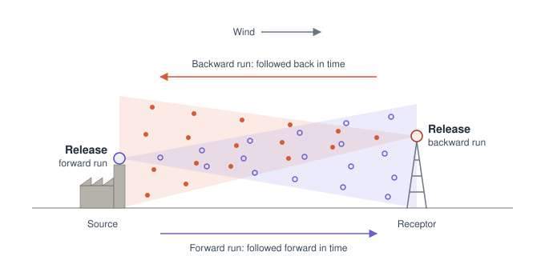

Releases (receptors)
====================

A :term:`release` is a place and time that particles start from, in either
direction. In a backward run, the usual one, the particles start at the
receptor, the place you measured, and are followed back in time toward the
sources that influenced it. In a forward run they start at the source and
are followed forward toward where the air goes. A release placed at a
measurement and followed backward is what STILT calls a *receptor*, so in
these docs *release (receptor)* is the same thing. Pick the release type
that matches how your instrument samples the air.

.. _release-source-receptor:

         tower, the receptor, downwind on the right. A backward run releases
         particles at the top of the tower and follows them back in time
         toward the factory. A forward run releases particles at the factory
         chimney and follows them forward in time toward the tower.
   :align: center
   :width: 100%

   A release is where the particles start. Filled dots: a backward run is
   released at the receptor. Hollow dots: a forward run is released at the
   source.

.. currentmodule:: stilt

.. list-table::
   :header-rows: 1
   :widths: 25 40 35

   * - Release type
     - Use it for
     - You give it
   * - :class:`PointRelease`
     - An instrument sampling at one point, such as a tower inlet, a flask,
       or an aircraft or vehicle measurement (:doc:`tracks`)
     - ``longitude``, ``latitude``, ``altitude``
   * - :class:`ColumnRelease`
     - An instrument measuring the vertical column above one spot, such as a
       ground-based spectrometer (TCCON, EM27/SUN)
     - ``longitude``, ``latitude``, ``bottom``, ``top``
   * - :class:`MultiPointRelease`
     - A slanted line of sight, such as a solar-tracking spectrometer or an
       off-nadir satellite sounding (see :doc:`slant_columns`), or any set of
       release points at one time
     - ``longitudes``, ``latitudes``, ``altitudes`` (arrays)

Every release also needs a ``time`` in UTC. A timezone-aware time is
converted to UTC. Altitudes are in meters above ground level. Pass
``altitude_ref="msl"`` to give them above mean sea level instead.

PointRelease
-------------

This is the most common type. Use it for a fixed surface site or an airborne
sample at one height. For an analyzer that measures as it moves,
:doc:`tracks` makes these releases from its track.

.. ipython:: python

   import stilt

   release = stilt.PointRelease(
       time="2023-07-15 18:00:00",
       longitude=-111.848,
       latitude=40.766,
       altitude=10.0,          # meters above ground
   )

   @savefig releases_point.png width=5in
   release.plot.map();

ColumnRelease
--------------

Use it when the measurement covers a range of heights above one spot.
HYSPLIT releases the particles evenly in height between ``bottom`` and
``top``.

.. ipython:: python

   release = stilt.ColumnRelease(
       time="2023-07-15 18:00:00",
       longitude=-111.848,
       latitude=40.766,
       bottom=50.0,
       top=6000.0,
       altitude_ref="msl",
   )

   @savefig releases_column.png width=5in
   release.plot.map();

``bottom`` must be below ``top``. Above-ground altitudes cannot be negative.

A column footprint usually needs weighting by pressure, and often by the
instrument's averaging kernel. Add the ``pressure_weighting`` and
``averaging_kernel`` transforms for that (see :doc:`/guides/transforms`).

MultiPointRelease
------------------

Use it when the instrument looks along a slanted path, so the air it
samples is spread out both horizontally and vertically. OCO-2 soundings and
other satellite views with a full line-of-sight geometry are examples.

.. ipython:: python

   import numpy as np

   release = stilt.MultiPointRelease(
       time="2023-07-15 18:00:00",
       longitudes=np.linspace(-111.85, -111.80, 10),
       latitudes=np.linspace(40.76,  40.80,  10),
       altitudes=np.linspace(0.0,    8000.0, 10),
       altitude_ref="msl",
   )

   @savefig releases_multipoint.png width=5in
   release.plot.map();

The three arrays must have the same length. The release's ID is built from
a hash of its points, so listing the same points in another order gives the
same ID. To build the points from viewing angles instead of by hand, see
:doc:`slant_columns`.

.. warning::

   Every point must have its own horizontal location. HYSPLIT treats
   consecutive release points at the same latitude and longitude as one
   vertical line source, and releases particles only between the last two
   heights. Stacking several heights at one location would silently drop all
   but the top segment, so :class:`MultiPointRelease` raises
   ``ValueError`` instead.

   For a vertical column, use :class:`ColumnRelease`. For several separate
   heights at one location, run one :class:`PointRelease` per height (a
   distinct ``group`` in the CSV) and combine the footprints afterward.

Loading releases from a CSV file
---------------------------------

For more than a handful of releases, keep them in a CSV file. The simplest
form has one row per point release:

.. code-block:: text

   time,longitude,latitude,altitude
   2023-07-15 18:00:00,-111.848,40.766,10
   2023-07-15 19:00:00,-111.848,40.766,10

Write times in ISO 8601, such as ``2023-07-15 18:00:00`` or
``2023-07-15T18:00:00Z``, or as ``YYYYMMDDHHMM``, such as ``202307151800``.
A time with an offset, such as ``2023-07-15T12:00:00-06:00``, is converted
to UTC; one without is taken as UTC. Other forms are refused, naming the
row: ``05/07/2023`` could be 5 July or 7 May.

The column names from STILT-R also work. Use ``long`` or ``lon`` for
longitude, ``lati`` or ``lat`` for latitude, and ``zagl`` or ``zmsl`` for
altitude. A ``zmsl`` column means the altitudes are above sea level. To mix
the two in one file, add an ``altitude_ref`` (or ``height_ref``) column with
``agl`` or ``msl`` on each row. A column under another name that holds only
``agl`` and ``msl``, such as ``alt_ref``, is an error: it would be kept as a
label, and every height read as above ground.

To build a column or multipoint release, give its rows the same ``group``
value. Rows that share a ``group`` become one release, so they must also
share the same ``time``:

.. code-block:: text

   time,longitude,latitude,altitude,group
   2023-07-15 18:00:00,-111.848,40.766,0,1
   2023-07-15 18:00:00,-111.848,40.766,3000,1

Two rows at the same location make a :class:`ColumnRelease`. Rows at
different locations make a :class:`MultiPointRelease`.

Any other column is kept on the release in ``attrs``. A ``scene`` or
``site`` label you add to the file is also a column of
``project.releases`` and ``project.simulations``, so you can select
results by it with pandas (see :doc:`outputs`):

.. code-block:: python

   sims = project.simulations
   sims[sims.scene == "A"]

   releases = project.releases          # one row per release
   releases[releases.site.isin(["tower_a", "tower_b"])]

For a release built from several rows, the first row's labels are used.
``project.release(release_id)`` returns the release itself. A project
reads ``releases.csv`` as a table and builds a release only when you ask
for it, so opening a project of a hundred thousand releases takes a second
or two. The file is still checked as it is read: a longitude out of range
or a column of equal heights is an error at once.
:func:`~runtraj.releases.releases_to_frame` gives releases back as one
table with a row per release point, in the same columns as the file.

A project's ``releases.csv`` is read automatically. To load another CSV,
use :func:`read_releases`, or pass the path to the project:

.. code-block:: python

   releases = stilt.read_releases("my_releases.csv")
   project.add_releases("my_releases.csv")

Releases you add to a project later are appended to its ``releases.csv``
using the file's own columns (see :doc:`projects`). If a new release's
heights are above sea level and the file has no ``altitude_ref`` column, the
column is added.

How particles are released
--------------------------

``numpar`` is the number of particles released in each simulation.

- A :class:`PointRelease` releases all of them from its one location.
- A :class:`ColumnRelease` spreads them evenly from ``bottom`` to ``top``.
- A :class:`MultiPointRelease` divides them among its locations, and every
  location gets the same number: ``numpar // n`` for ``n`` locations, which
  HYSPLIT's rounding often raises by one. So a run can hold up to ``n``
  more particles than ``numpar``. With 1000 particles over 40 locations,
  each gets 26, 1040 in all; over 56 locations, each gets 17, 952 in all.

HYSPLIT stops releasing when it reaches ``maxpar`` and fills the locations
in order, so a ``maxpar`` set too low would leave the last locations with
fewer particles or none. Leave ``maxpar`` unset: PYSTILT then gives HYSPLIT
room for every location (``n * (numpar // n + 1)``). A run whose ``maxpar``
cuts a multipoint release short fails as ``PARTICLE_LIMIT``
(:doc:`checking`).

Advanced: release heights for multipoint and slant releases
------------------------------------------------------------

Vertical weighting needs each particle's release height, the
``release_height`` column of the particles. HYSPLIT does not record which
release point a particle came from, so PYSTILT works it out from the first
row HYSPLIT writes for the particle. With HYSPLIT 5.1.0, STILT-R's
build, that row comes one timestep after release. By then the wind
has moved the particle a few hundred meters, which can be more than the
spacing between the points of a slant column.

PYSTILT recovers release heights in this order:

1. If the HYSPLIT build writes rows at release time (``age = 0``), it
   uses them. The result is exact.
2. If the release altitudes are all different, as they are in a slant
   column, it matches particles by height. Height changes much less than
   horizontal position over one timestep, so this is accurate to about
   20 m.
3. Otherwise it matches by horizontal position. It warns when the release
   points are closer than 1 km, because the match cannot be trusted there.

To get exact release heights, run a HYSPLIT build that writes rows at
release time (:doc:`hysplit_build`):

.. code-block:: yaml

   # config.yaml
   models:
     hysplit:
       directory: /path/to/hysplit    # holds exec/hycs_std

The checksum of the build's ``hycs_std`` is part of the particles'
settings, and the version it prints is recorded beside them, so you can
tell which build made them.

Working with releases in code
------------------------------

The rest of this page is for code that handles any type of release.

Shared interface
~~~~~~~~~~~~~~~~

All three classes have these members:

``release.id``
   A string of the form ``YYYYMMDDHHMM_{location}``. It names the release's
   result files (see :doc:`projects`), so two different releases may
   not share one. For a point or column release it spells out the time,
   position, and heights, with ``msl`` at the end for heights above sea
   level. ``release.location_id`` is the location part.

``release.time``
   The release time, as a :class:`datetime.datetime` in UTC with no
   timezone attached.

``release.altitude_ref``
   ``"agl"`` or ``"msl"``.

``release.attrs``
   A dictionary of extra labels, such as the extra columns of
   ``releases.csv``. They are not part of the release's ID.

``release.coords()``
   The release's points as a list of ``(latitude, longitude, altitude)``.
   A :class:`PointRelease` has one point, a :class:`ColumnRelease` two
   (bottom and top), and a :class:`MultiPointRelease` one per location.
   This lets code read coordinates without checking the type.

``release.geometry``
   A shapely geometry: a ``Point``, ``LineString``, or ``MultiPoint``.

``release.plot.map()``
   A quick map of the release.

``release.to_dict()`` and ``Release.from_dict(d)``
   Convert to and from a JSON-friendly dictionary. The dictionary has a
   ``"kind"`` key (``"point"``, ``"column"``, or ``"multipoint"``), which
   ``Release.from_dict`` uses to rebuild the right class.

Releases are frozen. To change one, make a copy with
``release.model_copy(update={"altitude": 20})``. Every argument is given by
name, so a longitude cannot be passed as a latitude by mistake.

Checking the type
~~~~~~~~~~~~~~~~~

Use :func:`isinstance` to branch on the release type:

.. code-block:: python

   from stilt import ColumnRelease, MultiPointRelease, PointRelease

   if isinstance(release, PointRelease):
       print(f"Single point at {release.altitude} m")
   elif isinstance(release, ColumnRelease):
       print(f"Column from {release.bottom} to {release.top} m")
   elif isinstance(release, MultiPointRelease):
       print(f"Multi-point with {len(release.coords())} locations")

All three are subclasses of :class:`Release`.

Building a release from a list of points
~~~~~~~~~~~~~~~~~~~~~~~~~~~~~~~~~~~~~~~~~

:meth:`Release.from_points` takes a list of ``(longitude, latitude,
altitude)`` tuples and returns the matching type:

- one tuple gives a :class:`PointRelease`;
- two tuples at the same location give a :class:`ColumnRelease`, with
  ``bottom`` and ``top`` in the right order;
- anything else gives a :class:`MultiPointRelease`.

.. code-block:: python

   r = stilt.Release.from_points(
       time="2023-07-15 18:00:00",
       points=[(-111.848, 40.766, 10.0)],
   )
   # PointRelease
