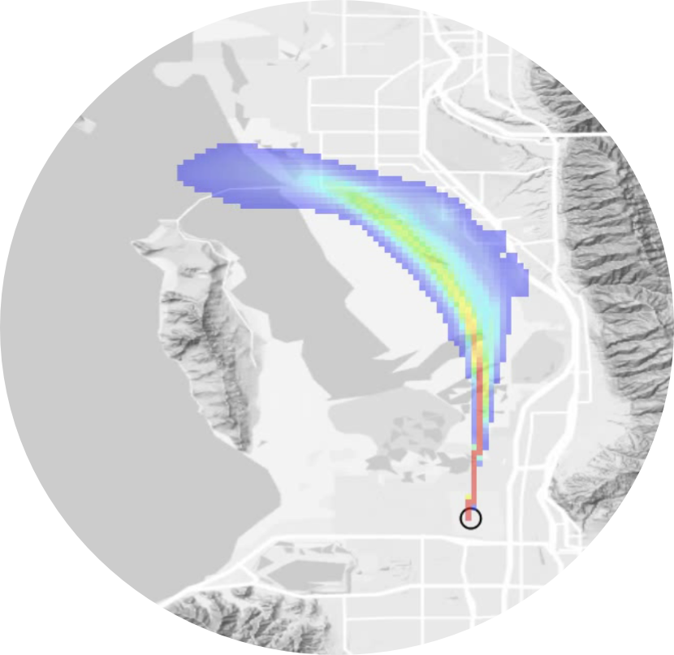

PYSTILT
=======

.. image:: https://zenodo.org/badge/DOI/10.5281/zenodo.22211796.svg
   :target: https://doi.org/10.5281/zenodo.22211796
   :alt: DOI

.. rst-class:: hero-copy

PYSTILT is a Python version of STILT, an atmospheric transport model. It
tells you where the air in a trace-gas measurement came from. Give PYSTILT the
place and time of your measurement and some meteorology, and it computes a
footprint. The footprint is a map of the upwind surface areas that influenced
the measurement, and by how much.

         north-northwest from a sensor in Salt Lake City toward the Great Salt Lake.
   :width: 320px
   :align: center

PYSTILT works for towers, aircraft, mobile platforms, and satellite or
ground-based column measurements. The same project can run one simulation on a
laptop or tens of thousands on an HPC cluster. The map above, from STILT-R's
documentation, is a footprint of a sensor in Salt Lake City.

.. note::

   PYSTILT is alpha software. Names and options may still change between
   releases. The :doc:`development/roadmap` shows what is settled.

.. grid:: 1 1 2 2
   :gutter: 2

   .. grid-item-card:: :fas:`play` Getting Started
      :link: getting_started/index
      :link-type: doc

      What a footprint is, how to install PYSTILT, and your first footprint
      map in a few steps.

   .. grid-item-card:: :fas:`graduation-cap` Tutorials
      :link: tutorials/index
      :link-type: doc

      Complete studies. A day of tower footprints, modeled concentrations
      from an inventory, and footprints of a satellite column.

   .. grid-item-card:: :fas:`book` User Guide
      :link: guides/index
      :link-type: doc

      How to describe your measurements, set up meteorology, run on a
      cluster, and load and plot results.

   .. grid-item-card:: :fas:`code` API Reference
      :link: reference/index
      :link-type: doc

      Every class, function, and configuration option.

Used STILT-R, X-STILT, stiltctl or Jena STILT before?
:ref:`Coming from another STILT <coming-from-another-stilt>` says where
their settings and steps are in PYSTILT.

.. toctree::
   :hidden:
   :maxdepth: 2

   getting_started/index
   tutorials/index
   guides/index
   reference/index
   development/index
